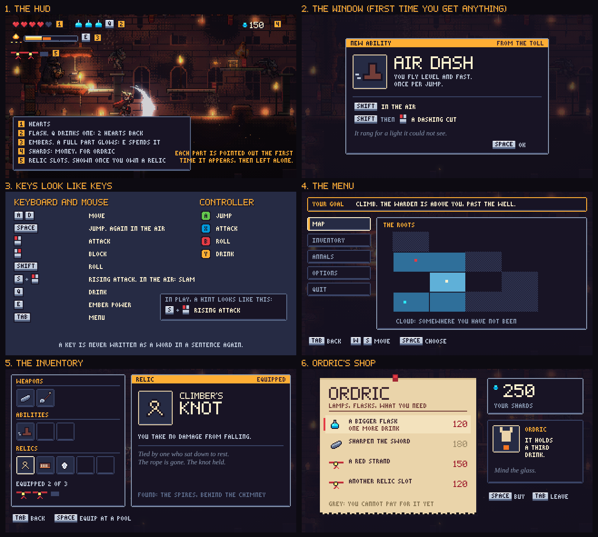

# The screens and the teaching (the sheet)

*Step 3 of the order agreed after the playtest of 21 Nov 2026. This is the written sheet, with mock-ups, to be agreed
before anything is built. The pictures are drawn with the game's own lettering and icons over a frame of the game, but
they are mock-ups: nothing in them is in the game yet.*

## What was said (both playtests)

- "Everything's the same font... it's just a wall of text." "Our design for text just isn't very nice still."
- "R to switch... does not stand out to me as a button. There has to be a design language."
- "The first time you get a relic or a tally, a window pops up... for the first time, everything that we gather."
- "Three yellow bars, I don't know what those are for... three empty squares."
- The pause menu: "so much text... not organized at all. A very nice UI."
- The shop: "it should feel like a shop." Each person a menu of their own.
- The inventory: "too unproportional." Relics want pictures; flavour text in italics, well written.
- "I don't like the idea of buying the map." "A fog of war."

## The rules (one design language)

1. **Three kinds of words, and they never look alike.**
   - **What it is:** large, cream, the pixel letters. One or two words.
   - **What it does:** small, pale. Says "you". One or two lines, never a list of five.
   - **Flavour:** a true italic, dimmer, last, and never more than two lines. It may hint at the world; it never
     carries an instruction. *(The pixel letters are five pixels tall and cannot slant and stay readable, so flavour
     is set in a second, real typeface at the screen's own sharpness. That is the second face you asked for.)*
2. **A key is drawn as a key.** A pale cap with its letter; the mouse as a mouse with the button lit; a controller's
   button as a round coloured button. A key is never again written as a word inside a sentence. (Mock-up 3.)
3. **One window for everything gained.** The same frame every time: a gold band saying what kind of thing it is and
   where it came from; its picture; its name; what it does; how to use it, each line starting with its key; one line
   of flavour; and one key to close it. (Mock-up 2.) It opens the first time for: the flask, a relic, the tally,
   knots, embers, a weapon, an ability. Where a person gave it or teaches it, his portrait sits at the window's top
   corner with his name.
4. **Nothing is on screen that has not been explained.** Each part of the HUD is pointed out once, when it first
   appears, and then left alone. A part he does not have yet is not drawn at all (no empty relic slots before a relic).
5. **A blocked way says so,** the first time he touches it: what it is, and that he cannot open it yet.

## The six screens

1. **The HUD.** Hearts. The flask with its key beside it. **A new ember meter:** one bar in three parts with a
   flame at its head; a full part glows, and the ember key appears beside it only when there is a part to spend.
   Shards with their crystal. Relic slots only once he owns a relic.
2. **The window.** As rule 3.
3. **Keys.** As rule 2, in every hint, every window, the options and the title's key list.
4. **The menu.** His goal in a strip across the top. Five tabs down the left (Map, Inventory, Annals, Options,
   Quit); the chosen one fills the right. Keys along the bottom. No paragraph of text anywhere on it.
   **The map uncovers as he walks:** a room he has not been in is not drawn; one that he knows is there (through a
   door he has seen) is drawn as cloud. The corner map does the same. **No maps are sold.**
5. **The inventory.** On the left, what he has, as pictures in a grid under three headings (weapons, abilities,
   relics); empty cells for what he could still find in that row. On the right, the chosen thing in the same window.
   His relic slots along the bottom.
6. **The shop.** Ordric's is a sheet of his own paper, pinned up: each thing a line with its picture, its name, what
   it does, and its price; what he cannot afford greyed. His shards large, apart. Ordric's portrait and one line from
   him about the thing chosen. Each other person gets a thing of their own in the same layout: Corwen an open book,
   Hob a miner's tally board.

## In what order

> **Built so far:** A is build 82 (the window, the keys, the flask's teaching); B is build 83 (the HUD, the menu, the
> inventory). C is build 84 (the shop, the map in cloud). Left over: the Lore book and Options in the new look,
> Corwen's and Hob's own menus when they have something to offer, and better pixel work on the relics' pictures. You asked for it to be more of the game's own world: every panel is the mountain's stone
> with his ribbon tied across its head, and the chosen button wears a piece of the ribbon.

Three builds, each played before the next.

| Build | What |
|---|---|
| A | The window, the key caps, and the first-time teaching for all seven kinds of thing (T1 to T4), blocked ways (T5), the italic face |
| B | The HUD and the ember meter (U4, U5), the menu and the inventory (U1, U3), with a picture for every relic |
| C | The shop (U2), the map that uncovers and no maps sold (U8), the map marks explained (T7) |

## For you to settle

1. **Is this the look?** Say what is wrong with any of the six. It is cheap to change now.
2. **The italic face.** I used a plain serif italic as a stand-in. Do you want something more of the game's world
   (an old book hand), or plainer?
3. **Corwen without maps to sell:** what does he give for finding him? My suggestion: his mark on the map of what is
   still to be found in that region, which is what his chart does today besides showing the rooms.
4. **The little character who teaches (rule 3).** A person's portrait in the corner when a person gave the thing. For
   things nobody gives (a relic from a chest), nobody: or would you rather one guide throughout?
